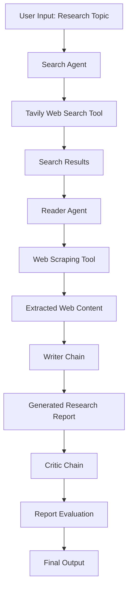

# AI Research Assistant

An AI-powered research and report generation system that automates web research, information extraction, content synthesis, and report evaluation using LangChain, LLMs, and web search tools.

The system follows a structured research pipeline in which specialized agents gather and extract information, while dedicated LLM chains generate and evaluate the final research report.

## Overview

Researching a topic often involves searching multiple sources, extracting relevant information, organizing findings, and evaluating the quality of the final content.

This project streamlines that process through an AI-powered workflow that combines web search, webpage scraping, LLM-based writing, and report evaluation.

Users can enter a research topic and receive a structured report generated through multiple processing stages.

## Key Features

- **Automated Web Research:** Retrieves relevant information from the web using the Tavily Search API.
- **Intelligent Information Extraction:** Identifies relevant webpages and extracts their textual content for deeper analysis.
- **AI-Powered Report Generation:** Generates structured research reports using an LLM.
- **Report Evaluation:** Uses a dedicated critic chain to assess report quality, identify strengths, and suggest improvements.
- **Streamlit Interface:** Provides a user-facing interface for interacting with the research pipeline.
- **Modular Architecture:** Separates search, extraction, writing, and evaluation into independent components.

## System Architecture

The application follows a sequential research workflow consisting of two tool-using agents and two LLM chains.



### Workflow Components

| Component | Responsibility |
|---|---|
| Search Agent | Searches the web for relevant information using Tavily. |
| Reader Agent | Selects relevant URLs and extracts webpage content using the scraping tool. |
| Writer Chain | Synthesizes the gathered information into a structured research report. |
| Critic Chain | Evaluates the generated report and provides a score, strengths, and areas for improvement. |

## Technology Stack

| Technology | Purpose |
|---|---|
| Python | Core programming language |
| LangChain | Agent creation, prompt management, and LLM orchestration |
| LangGraph | Agent execution and workflow management |
| Groq | LLM inference |
| GPT-OSS-120B | Language model used through Groq |
| Tavily API | Web search and information retrieval |
| Requests | Fetching webpage content |
| BeautifulSoup4 | HTML parsing and text extraction |
| Streamlit | User interface |

## Project Structure

```text
ai-research-assistant/
│
├── app.py              # Streamlit application
├── agents.py           # Search and Reader agents,
│                       # Writer and Critic chains
├── tools.py            # Tavily search and web scraping tools
├── pipeline.py         # Research pipeline orchestration
│
├── requirements.txt    # Project dependencies
├── .env.example        # Environment variable template
├── .gitignore          # Git ignored files
└── README.md           # Project documentation
```

## Getting Started

### Prerequisites

Before running the project, ensure you have:

- Python 3.10 or later
- Git
- A Groq API key
- A Tavily API key

### 1. Clone the Repository

```bash
git clone https://github.com/priyaraut222/AI-Research-Assistant.git
cd ai-research-assistant
```

### 2. Create a Virtual Environment

```bash
python -m venv .venv
```

Activate it:

**Windows (PowerShell):**

```powershell
.venv\Scripts\Activate.ps1
```

**macOS / Linux:**

```bash
source .venv/bin/activate
```

### 3. Install Dependencies

```bash
pip install -r requirements.txt
```

### 4. Configure Environment Variables

Create a `.env` file in the root directory.

Add your API credentials:

```env
GROQ_API_KEY=your_groq_api_key
TAVILY_API_KEY=your_tavily_api_key
```

You can obtain API keys from:

- [Groq Console](https://console.groq.com/keys)
- [Tavily](https://app.tavily.com/)

**Important:** Never commit your `.env` file or expose your API keys publicly.

### 5. Run the Application

Launch the Streamlit interface:

```bash
python -m streamlit run app.py
```

Alternatively, run the research pipeline directly:

```bash
python pipeline.py
```

## Example Usage

1. Launch the application.
2. Enter a research topic.
3. The Search Agent retrieves relevant web results.
4. The Reader Agent extracts information from selected webpages.
5. The Writer Chain generates a structured research report.
6. The Critic Chain evaluates the report and provides feedback.
7. View the resulting research output through the application.

**Example research topics:**

- Recent developments in Artificial Intelligence
- Emerging trends in renewable energy
- Applications of Generative AI in healthcare
- Recent developments in cricket

## Report Structure

The generated research report follows a structured format:

- Introduction
- Key Findings
- Conclusion
- Sources and References

The Critic Chain separately evaluates the report based on its quality, strengths, and areas requiring improvement.

## Current Architecture & Scope

The project currently implements a predefined sequential workflow with specialized agents and LLM chains.

The Search and Reader agents use explicitly assigned tools, while the Writer and Critic components operate as LLM chains.

This modular structure provides a foundation for exploring more advanced agent orchestration, dynamic decision-making, and iterative research workflows.

## Future Enhancements

- Introduce iterative research and report refinement.
- Implement dynamic agent routing and task delegation.
- Add source verification and improved citation handling.
- Support PDF uploads and document-based research.
- Add report export functionality (PDF/DOCX).
- Improve error handling and retry mechanisms.
- Explore persistent memory and conversation history.
- Enhance the evaluation process with more detailed quality metrics.

## Learning Objectives

This project explores practical implementation of:

- LangChain agents and tools
- LLM chains and prompt engineering
- Tool calling and API integration
- Web scraping and information retrieval
- Sequential AI workflow orchestration
- LLM-based content generation and evaluation
- Building AI applications with Streamlit

## Contributing

Contributions, suggestions, and improvements are welcome.

1. Fork the repository.
2. Create a feature branch.
3. Commit your changes.
4. Open a pull request.
